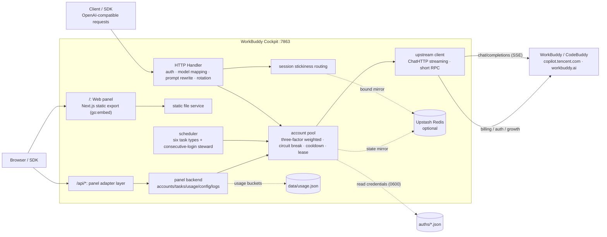

<div align="center">


# WorkBuddy Cockpit

**Turn WorkBuddy / CodeBuddy accounts into an OpenAI-compatible API — and manage all of it in one place**

Multi-account gateway · Embedded web admin panel · Task automation · Usage observability · Single-container deployment

[](https://github.com/Arimayuki03/workbuddy-cockpit/releases/latest)
[](https://github.com/Arimayuki03/workbuddy-cockpit/releases/latest)
[](https://github.com/Arimayuki03/workbuddy-cockpit/actions/workflows/build.yml)
[](LICENSE)
[](https://go.dev)
[](web/)
[](https://github.com/Arimayuki03/workbuddy-cockpit/pkgs/container/workbuddy-cockpit)
[](https://github.com/Arimayuki03/workbuddy-cockpit/stargazers)

**English** · [简体中文](README.md) · [Features](#-features) · [Quick start](#-quick-start) · [Configuration](#️-configuration) · [Architecture](#️-architecture) · [Versions](#-versions) · [Docs](#-docs) · [Disclaimer](#️-disclaimer)

</div>

---

## 📖 Overview

WorkBuddy Cockpit is a self-hosted all-in-one project: the **backend** is a multi-account OpenAI-compatible gateway (OAuth login, account pool rotation, circuit breaking and cooldown, session stickiness), and the **frontend** is a full-featured web admin panel embedded in the same binary (accounts, tasks, usage, configuration, logs). Deploy one container, remember one address — that's all.

> This project started as a fork of [Sliverkiss/workbuddy2api](https://github.com/Sliverkiss/workbuddy2api) (**the upstream repository was deleted by its author on 2026-09-23 and is no longer accessible**; the link is kept for historical attribution only; this project continues independently under the MIT license). Since v1.2.0 it has evolved independently: it absorbed the backend management capabilities of [workbuddy2api-panel](https://github.com/linguo2625469/workbuddy2api-panel) and the frontend design of [workbuddy-manager](https://github.com/ithtelab/workbuddy-manager), while keeping the gateway core source-compatible with upstream. See [docs/DESIGN-v1.2.0-panel-manager.md](docs/DESIGN-v1.2.0-panel-manager.md) for the design decisions.

### Relationship to upstream and similar projects

| | Upstream workbuddy2api | workbuddy2api-panel | workbuddy-manager | **This project** |
|---|---|---|---|---|
| Form factor | Pure gateway, no panel | Gateway + native HTML panel | External panel (Python middleware + Next.js) | **Gateway + embedded Next.js panel** |
| Deployment | Single container | Single container | Gateway + panel, two containers | **Single container** |
| Account pool governance | ✓ | ✓ | — (calls the gateway API) | ✓ (upstream-compatible + cost_explore) |
| Task automation | ✓ built-in seven schedulers | ✓ all built in | Depends on Python scripts | ✓ built-in scheduling + one-click growth tasks / sequential task chains |
| Usage statistics | Aggregated `/v1/stats` | Per-request buckets | Self-built SQLite | **Both** |
| Windows workflow | ✓ cmd start/stop scripts | — | Scripts | ✓ cmd start/stop + interactive .bat menu + full CLI |

## ✨ Features

### 🔑 Multi-key distribution (`wbk_`)

The **API Keys** page lets you create multiple independent distribution keys (prefix `wbk_`) instead of a single global `api_key` (the global key remains supported). Each key has its own: **realm restriction** (cn / global / any), expiry, maximum IP count, IP allowlist (CIDR), model allowlist, token quota, **credit quota** (accumulated from real upstream charges) and per-minute rate limit. Plaintext is shown only once at creation; only a SHA-256 digest is stored. Rejection classes are unambiguous: parameter/configuration problems → 400, unusable credentials → 403, quota exhausted → 429 `insufficient_quota`. Only admitted requests count toward the rate-limit window and usage. The creation dialog exports ready-made snippets for 9 clients (Claude Code / Codex / cc-switch / ZCode / OpenAI SDK, etc.), eliminating wrong-direction key mistakes.

#### Client balance protocol (v1.24.0)

The gateway exposes three balance endpoints so client panels can show the remaining quota of a key: `/v1/credits` (the default `/credits` path of OpenAI-compatible clients such as RikkaHub; `total_usage` equals `total_available`), `/api/usage/token/` (new-api style: `total_granted` / `total_used` / `total_available`) and the public metadata endpoint `/api/status` (declares only the unit `UNIT`, no quota). Supports `?scope=cn|global|merged` to aggregate by realm; when a key has both token and credit quotas, the tighter remaining ratio is used. Balance endpoints validate only the key itself — disabled/expired/quota-exhausted keys can still query how much they have left.

### 🔀 Dual-protocol passthrough (Anthropic Messages + OpenAI Responses)

- **Anthropic Messages API** (`/v1/messages` + `/v1/messages/count_tokens`) — Anthropic-protocol clients such as Claude Code connect without a conversion layer. Both `thinking` modes (enabled / adaptive) are supported. Images embedded in `tool_result` are correctly extracted as vision input (no more base64 stuffed into text and blowing up the context). `count_tokens` uses a conservative CJK / non-CJK estimate. Authentication matches chat completions (same key). Streaming is translated on the fly through `io.Pipe` (before v1.17.1 it was fully buffered fake-streaming); parallel `tool_calls` are slotted by upstream `index` so interleaved argument fragments never cross blocks (v1.17.1).
- **OpenAI Responses API** (`/v1/responses`) — Responses clients such as Codex connect directly. `instructions` / input items are fully converted, reasoning items are leniently backfilled (to avoid the upstream 11155 "missing reasoning content" loop), `prompt_cache_key` is passed through (a measured ~17× cost difference on cache hits), and namespace tools are bridged to function calls. Non-streaming tool calls return the client's original tool name instead of the internal outbound name (v1.17.1).

### 🔎 Search protocol shell (`POST /v1/search/messages`)

Aimed at DSH's built-in search provider: point the search baseURL at `<gateway>/v1/search` and send an Anthropic-Messages-compatible `web_search` request. The gateway calls upstream `/agenttool/v1/search` directly and returns `web_search_tool_result` + citations, without invoking a model. It shares `withAuth`, IP allow/block lists, the global `api_key` and panel session channel with chat, and reuses account-pool selection, in-flight leases, token pre-refresh and `applyErrorPolicy` cooldown; no unauthenticated entry point is added. **`wbk_` distribution keys are explicitly rejected with 403 on this endpoint**: search produces no model token/credit usage, and until search quota semantics are defined it stays closed to avoid bypassing existing model/token/credit limits. `allowed_domains` / `blocked_domains` / `user_location` / `stream=true` return an explicit 400 because upstream does not support them (never silently ignored). Each request performs one search; `max_results` is capped at 10. Tests use only a fake upstream; no real external search verification was performed.

### 🛡️ Inbound IP security

The `security` section (`trusted_proxy_cidrs` / `trusted_proxy_hops` / `ip_blacklist` / `ip_whitelist` / `ip_whitelist_mode`): **the default configuration trusts no forwarding headers at all** — in a direct deployment, a forged `X-Real-IP` cannot bypass any IP control. Behind a reverse proxy / CDN, declare the trusted proxy networks and only then will the gateway recover the real source from `X-Forwarded-For` (in multi-hop scenarios `X-Real-IP` is never trusted; only XFF is walked right-to-left, v1.17.1). The panel's **Security** page offers hot editing of IP rules (a failed validation leaves everything unchanged and never wipes existing rules on "rollback", v1.17.1), a block log (blocks only, 512-entry ring) and a model-lock card; on read/parse failure the rule file is kept and a clear warning is emitted instead of silently falling back (v1.17.1).

### 💰 credit_floor

`pool.credit_floor` (0 = off): accounts below the floor do not receive paid models (cost is judged using per-model credit multipliers), preventing depleted accounts from burning credits. The all-cooling fallback path uses the same criterion, leaving no back door for depleted accounts. The multiplier table is prewarmed at startup and refreshed when the model catalog updates. Accounts resume automatically after check-in restores credits.

### 🎛️ Web admin panel

Open it in a browser; it shares the gateway port and authentication, supports light/dark themes and five languages (Simplified Chinese / Traditional Chinese / English / Japanese / Korean):

- **Overview** — account health distribution and today's requests / tokens / credit charges at a glance; expiring-credit aggregation can be switched by day (local preference)
- **Accounts** — pool overview (status / credit progress bar / cooldown countdown / success-failure counters / in-flight count); per-account disable / restore / revive / check-in / balance query / remove; batch check-in / keepalive / balance refresh; **QR-code / OAuth login to add accounts**, credentials hot-loaded into the pool after being written to disk, no restart; **credential export / import** (migrate accounts across deployments, same UID overwrites); **force-clear cooldowns** (cooldown / circuit break / consecutive-failure demotion / model-level rate limit zeroed in one click, without touching the disabled flag); **account notes** (persisted in state.json on the backend, survive browser changes) and **search + pagination**; **manual selection weight** (scale icon, `0.1..100` multiplier, default 1; persisted as top-level `weight` in the auth file and preserved across export/import and token refresh; cooldown / circuit break / disabled / in-flight / cost tier / `credits_desc` hard gates are unaffected); credit-change ledger (balance snapshots compared on refresh, increases recorded)
- **Tasks** — one-click growth-task automation (30+ task actions completed purely via API: advance → poll scoring → auto-claim; the execution queue is serial per account and concurrent across accounts; includes mini-program Sequential_Tasks_1..7 chains — expert chat, 5/10 conversations, GLM5.2, inspiration features, etc., with chain dependencies retried automatically on daily unlock, **locked rings excluded from the to-do list**, and mini-program conversation reporting paced like a human — 45s+ random jitter per message, interruptible by queue cancellation); **v1.25.0 coverage completion** — expert family `WorkBuddy_Valorant` / four `expert_use_*` tasks (dynamic `jump_url` resolution + constant fallback), `skill_share` (real share channel + channel events), two mini-program campaign tasks (Starbucks / Journalist's Day, 5 items total, `viewed → event → read-back → claim → claimed_at` closed loop, app skipped in the first release), plus the cat-travel **blind box** (`buddy/quota` + `buddy/open`, strictly `claim → idle read-back → open → depart`); historical coupon QR lookup (the back-to-school loop ended with the campaign on 2026-09-24); snapshots of six scheduled task types and manual triggering; **credit-change ledger** (task center records kind=credit)
- **Statistics** — per-request usage buckets (time slice × realm × account × model) timeline charts + request count / tokens / latency / charges aggregated by model / account / **credits (including credit price per million tokens; only paired tokens observed together with credits count toward the ratio)**; time-window filters apply to charts and tables together; windows include last 24h / 72h / 7d / 30d presets and a "since start" full range
- **Logs** — request logs (model / account / status / tokens / time-to-first-token / charges / errors / **three-part prompt cache hit observation**, ring buffer of ~1000 entries) + system logs (tasks / conversations / system channels); request logs support **JSONL archiving** (`data/requests/` rotated daily, survive restarts; retention days and size cap configured in the `logging` section; client_ip / user_agent collection is off by default)
- **Security** — **IP allow/block rule editing** (CIDR, hot-applied), **block log** (blocks only, 512-entry ring: missing_key / invalid_key / ip_blocked / ip_not_whitelisted), **model lock card** (locked / starved / partial states, earliest / full unlock times)
- **API Keys** — **multi-key distribution management** (see above): create / disable / reset usage / view bound IPs; the creation dialog provides 9 client configuration snippets at once
- **Settings** — hot configuration editing (deep-merge atomic write-back; some keys apply immediately, scheduler hours can be hot-changed without restart, now split into sub-routes), Upstash connectivity test, **model mapping** (custom model name → real model, for clients such as cc-switch with hard-coded model names), **scoped API token management** (`wbt_` prefix, read-only / admin tiers, for CI / scripts calling the panel API), update check; ⌘K command palette available globally, load-failure vs. empty states distinguished, global error fallback page
- **Playground** — chat directly inside the panel through this gateway's `/v1/chat/completions`

### 🐝 Account pool governance

- **OAuth device-authorization login** — `login.sh` / QR-code add-account in the panel; tokens refresh automatically, credentials are written to disk and hot-loaded
- **Three-factor weighted random selection** — credit ratio ×10 + expiring-credit share ×8 + idle compensation; a Top-5 shortlist is drawn from to prevent thundering herds; `pool.pick_strategy` can switch to `credits_desc` (strictly pick the highest balance; hot-applied in the panel; the first assignment of sticky sessions follows the same strategy — under credits_desc a new session binds to the highest-balance account, under weighted it draws within the idle candidate set by the three factors, and expiring credits are consumed first for sticky traffic)
- **In-flight leases** — per-account maximum concurrency; `/status` exposes `in_flight_by_model` per-model in-flight ledgers
- **Ledger-based selection** — price per thousand tokens derived from `usage.credit` is recorded in an (account, model) ledger; free / cheap accounts go first; observation is EMA-smoothed and expires after 6h
- **Cost-tier conditional exploration** — when tier 0 monopolizes traffic, ride-along rerouting explores unknown accounts, serving real requests with zero extra upstream calls and graduating on success
- **Tiered circuit breaking and cooldown** — 429 soft cooldown with exponential backoff, 402 hard cooldown until 04:00 next day (not overridden by soft cooldown / rate-limit flips; zero-balance accounts do not return early), consecutive-failure circuit breaking, model-level rate-limit cooldown (exempt when switching models), WAF IP-level fail-fast; operators can **force-clear cooldowns** from the panel. Check-in / balance refresh unfreezing clears only account-level cooldowns, without resetting soft rate-limit backoff exponents or model-level ledgers (restored balance does not prove the chat channel is healthy, avoiding zero-balance accounts repeatedly returning and hitting 429)
- **Model lock visibility** — `/status` exposes the current model-level cooldown aggregate (locked / starved / partial, earliest / full unlock times); when the whole pool is model-level blocked, 503 returns `model_blocked` instead of the misleading "no available account", so client backoff strategies are no longer conflated
- **Session stickiness** — derived from the four conversation keys → `prompt_cache_key` → first user message, keeping multi-turn context on the same account; stickiness is validated per model
- **Dual-realm support** — the CN edition (`copilot.tencent.com`) and the international edition (`www.workbuddy.ai`) share one pool; CN models are exposed by bare name, international models carry a `global:` prefix, and explicit `cn:` remains compatible

### ⏰ Scheduled credit tasks

Seven task types with independent schedules and switches (`schedule.*_enabled`); **trigger hours can be hot-changed from the panel / API without restart**: check-in (09/21, followed automatically by the consecutive-login steward: auto-redeem at 7/14/28 tiers + auto-draw all lotteries), activity map (10), cat travel (09/21, adoption state machine fixed), token keepalive (22), night owl (01), task execution queue (10, off by default), **daily compensation claim** (`compensation_*`, off by default — campaign compensation normally requires a manual claim on the web "usage management" page; when enabled it claims once a day, claims when available and skips otherwise, never double-claims on repeated runs, and skips international accounts; the panel's Tasks page can also "run now" and report how many accounts claimed and how many credits in total). **Task randomization** (`schedule.random_delay_minutes` / `account_delay_min_seconds` / `account_delay_max_seconds`, all off by default): automatic tasks can be delayed randomly 0–60 minutes after the hour (the offset is deterministically derived from deployment seed + date + task family — unchanged after a restart on the same day, different across deployments, and the seed never appears in logs); within a batch, accounts can be staggered randomly by 0–600 seconds (human rhythm); this applies only to automatic schedules — "run now" in the panel still runs immediately. **Token renewal patrol** (`schedule.renew_hours` / `renew_enabled`, default [3] and off): picks accounts by remaining lifetime — accounts within the `pool.expiring_soon` window (default 7 days) are actively refreshed, covering long-idle accounts with no conversation traffic; accounts manually disabled in the panel are skipped (traffic removed, credentials kept), while accounts with abnormal timers (cooldown / circuit break) are still renewed. **Sleep catch-up**: when the process sleeps across an hour slot (system sleep / host suspension), after waking it runs the missed slots within the window (24h) in ascending time order, merging task types at the same moment and running batches in parallel; the `school_*` keys are kept only for old-config compatibility (the campaign has ended; triggers are skipped). Both the panel and `/admin/tasks` can trigger manually; a single task panic is recovered and never takes down the gateway process. **Task reward claim-only sweep** (`schedule.task_sweep_enabled` / `task_sweep_interval_minutes`, off by default, minimum interval 15 minutes): independent of the task queue and campaign compensation; it scans only the growth task list and performs pre-accept + claim on completed rewards already reported as `Claimable` by upstream; it never starts conversations, executes task actions, or runs chat-consuming tasks, and makes zero requests for international / enterprise / disabled / manually disabled accounts. It is mutually exclusive with task locks and the task-center queue: if an account's task lock is held, that account is skipped; if the task-center queue is running, the whole round is skipped. On process exit, subsequent requests stop with the signal context (the upstream task API has no ctx parameter, so an in-flight single HTTP request may run until its own timeout; production exit waits at most 5s before terminating).

### 🔌 OpenAI-compatible API

- `/v1/chat/completions` streaming + non-streaming (outbound forced to stream, SSE allowlist rebuild, local aggregation for non-streaming), **`/v1/messages` + `/v1/messages/count_tokens` (Anthropic Messages protocol, Claude Code direct)**, **`/v1/responses` (OpenAI Responses protocol, Codex direct)**, **`/v1/search/messages` (DSH web-search protocol shell, Anthropic `web_search_tool_result` compatible)**, `/v1/models` (effort levels / credit multipliers / full context fields), `/v1/stats`, `/status`, `/healthz` — all sharing the same authentication
- Outbound rewrite pipeline: force `stream:true`, normalize the `developer` role, normalize `tool_choice`, accept string `image_url`, inject DeepSeek reasoning chains, downgrade `reasoning_effort` levels, infer missing `type` in tool schema `enum` (Kimi 11133), backfill `reasoning_content`, redact fingerprints, **normalize prompt-cache-hit aliases** (when some upstreams report a real `details.cached_tokens` but leave the flat alias at 0, write back the maximum positive value across aliases so downstream no longer misjudges a miss); `reasoning_as_content` (default false, requires restart) only for reasoning-only turns with no body text and no tool calls, delivering the thinking text as content too — content-only clients must opt in explicitly, while dual-field clients keep the default to avoid duplicate display
- **Outbound fix batch** (absorbing real cases from both upstreams): clamp GPT-family `max_tokens<16` (prevent 11133 from rotating the whole pool); normalize escaped `\_` in tool schema patterns (prevent 11129 wholesale rejection); merge back-to-back `tool_calls` messages (prevent 11148 `tool_call_sequence_broken` from deadlocking a session); pass 11101 bad_params straight through as 400 without rotation (deterministic failures must not masquerade as "account unavailable"); upstream timeout stop-loss (no account switch, no penalty, no consecutive-failure count); delay the streaming success verdict until real success (an upstream "200 stream open + one error frame" no longer marks a rate-limited account as healthy or pins stickiness to it)
- System prompt three modes (passthrough / custom / append) + content-block fallback retry
- Model mapping, error classification rotation backoff; international model catalog **probed concurrently with multiple UAs and unioned** (desktop / IDE / CLI — desktop UA fills gaps, IDE UA fields are authoritative, CLI UA adds missing deepseek ids), trial-banner models added to the catalog automatically; context window resolved with a four-level fallback (remote authority → static knowledge table → model.json cache → models.dev on demand)

### 🖥️ Native Windows workflow

**启动服务.bat** interactive menu (credits / check-in / tasks / start-stop / logs / add account / stats / account operations), with a full CLI suite: `login.exe` / `credit.exe` / `acct.exe` / `stats.exe` / `task.exe`, etc. In source mode just run `go run ./cmd/server`. See [使用指南.md](使用指南.md) (Chinese).

## 🚀 Quick start

### Option 1: Docker Compose (recommended)

```bash
git clone https://github.com/Arimayuki03/workbuddy-cockpit.git
cd workbuddy-cockpit
mkdir -p config && cp config.example.json config/config.json
# Edit config/config.json: set at least api_key; required when panel or admin is enabled (fail-fast if missing)
docker compose up -d --build

# Open the panel
# http://localhost:7863/   →  login password = the api_key you set
```

> You can also use the CI-prebuilt image `ghcr.io/arimayuki03/workbuddy-cockpit:latest` (multi-arch amd64/arm64; replace `build: .` in compose with `image:`). The ghcr image is published by [Build & Publish](.github/workflows/build.yml) on every `v*` tag; release binaries (Windows zip / Linux / macOS, including task tool exes and sha256 checksums) are uploaded automatically as release assets. If the image cannot be pulled, the Workflow page also offers an amd64 offline tar.gz.

Add an account: use the panel's **Accounts** page (QR code / OAuth login) or `./login.sh`.

### Option 2: build from source

```bash
# Frontend panel (requires Node 22+; output is embedded into the binary)
cd web && npm ci && npm run build:export && cd ..
cp -r web/out internal/panel/dist   # Windows: robocopy /MIR web\out internal\panel\dist

# Backend (-tags embed_panel enables the embedded panel; without it you get a pure gateway build)
go build -trimpath -tags embed_panel -ldflags="-s -w" -o wb2api ./cmd/server
./wb2api -config config.json
# Development run: go run ./cmd/server -config config.json
```

> ⚠️ Building with `-tags embed_panel` while `internal/panel/dist/` is missing **fails the build immediately** (fail-fast: never embed a broken frontend). Build and copy the frontend first.

### Option 3: Windows one-click script

Double-click **启动服务.bat** for the interactive menu (automatically builds required tools, detects ports and zombie processes). With a release exe, just double-click: on first start, if no config exists, it generates a minimal `config.json` with a random `api_key` and prints the key (the error window stays visible on double-click failures). See [使用指南.md](使用指南.md) (Chinese).

### Option 4: NanoPi R28S / OpenWrt ARM64

Run on FriendlyWrt / OpenWrt (aarch64, ~1 GiB RAM) as a **single container with host networking**: bind-mount three directories `/opt/wb2api/{config,auths,data}`, mount the main binary and `resolv.conf` read-only; a procd-managed `wb2api-admin-proxy` forwards LAN / Tailscale port `17863` to `127.0.0.1:7863`.

The deployment guide uses generic paths and address placeholders and covers stop-and-backup, upload and runtime file verification, failure rollback, and authentication acceptance steps; the admin bridge is optional and must be provided by you.

- Full directory layout, `docker run` arguments, low-write / upgrade / backup / security boundaries: [docs/DEPLOY-R28S.md](docs/DEPLOY-R28S.md)
- Use cases: ARM64 mini PCs / soft routers / NAS; x86 and desktop still recommend Option 1 / 2 / 3

### Verification

```bash
# Gateway identity and health
curl -s http://localhost:7863/healthz

# Model list / account status / request statistics
curl -s http://localhost:7863/v1/models  -H "Authorization: Bearer your-api-key"
curl -s http://localhost:7863/status     -H "Authorization: Bearer your-api-key"
curl -s http://localhost:7863/v1/stats   -H "Authorization: Bearer your-api-key"

# Streaming chat
curl -sN http://localhost:7863/v1/chat/completions \
  -H "Authorization: Bearer your-api-key" -H "Content-Type: application/json" \
  -d '{"model":"deepseek-v4-flash","messages":[{"role":"user","content":"hi"}],"stream":true}'
```

### Connecting clients

Since v1.16.0, Claude Code and Codex can **connect directly without a conversion layer** (Anthropic protocol via `/v1/messages`, Responses protocol via `/v1/responses`; configuration examples in the [usage guide](使用指南.md), Chinese). When creating a key on the panel's **API Keys** page, you can export the matching client snippet directly.

Take **cc-switch** (a local converter for Claude Code and other Anthropic-protocol clients) as an example:

- **Base URL**: `http://127.0.0.1:7863/v1`, **API Key**: the `api_key` from `config.json` (or a `wbk_` distribution key)
- **Suggested model mapping**: Default / Sonnet / Opus → `deepseek-v4-pro`; Haiku / Subagent → `deepseek-v4-flash`
- Hard-coded client model names (e.g. `gpt-4o`) can be mapped by full name to a gateway model under `/settings` → model mapping

## ⚙️ Configuration

See [`config.example.json`](config.example.json) for the complete reference; `WB2A_*` environment variables override values (including `WB2A_CONFIG` to set the config path). Common sections:

```jsonc
{
  "listen": ":7863",            // listen address
  "api_key": "your-gateway-key", // gateway auth key (required when panel/admin is on; startup is refused if missing)
  "auth_dir": "./auths",        // account credential directory (5s polling hot reload)
  "upstash": { "url": "", "token": "" }, // mirror state to Upstash Redis (optional)
  "usage":   { "enabled": true },  // per-request usage buckets written to data/usage.json
  "panel":   { "enabled": true, "loopback_only": false }, // web admin panel
  "schedule": { "checkin_enabled": true, "checkin_hours": [9, 21], "queue_enabled": false } // seven task schedules (hot-editable in the panel; includes daily compensation and task randomization)
}
```

| New key | Default | Description |
|---|---|---|
| `panel.enabled` | `true` | Enable the web panel (turn off to return to a pure gateway) |
| `panel.loopback_only` | `false` | Restrict the panel to loopback (keep false behind a public reverse proxy) |
| `usage.enabled` | `true` | Per-request usage bucket statistics (when off, the stats page only shows `/v1/stats` aggregates) |
| `schedule.queue_hours` / `queue_enabled` | `[10]` / `false` | Task-center execution queue schedule (off by default; can be triggered manually on the panel's Tasks page) |
| `schedule.renew_hours` / `renew_enabled` | `[3]` / `false` | Independent token renewal patrol: actively refresh accounts within the `pool.expiring_soon` window (manually disabled accounts are skipped) |
| `pool.pick_strategy` | `weighted` | Selection strategy: `weighted` three-factor weighted random / `credits_desc` strictly pick the highest balance (hot-changed on the panel's Settings page, no restart) |
| `pool.credit_floor` | `0` | Credit floor: accounts below it do not receive paid models (cost converted with model multipliers) to prevent depleted accounts from burning credits; 0 = off |
| `pool.large_request_bytes` / `large_request_budget` / `large_request_budget_window` | `2097152` / `6` / `120s` | Per-account sliding budget for large requests: an account serves up to the budget count within the window before yielding, with one session migration and re-binding; prefix cache is preserved by default, and `large_request_cooldown` only enables legacy per-request rotation when the budget is off |
| `pool.prefer_expiring` | `true` | Prefer consuming expiring credits: the earliest-expiring account with remaining balance gets ×3 weight in weighted selection and 3 copies in the sticky-session candidate list (does not adopt upstream hard ordering; keeps the three factors and coexists with `credits_desc`); `false` = legacy behavior (hot-changed on the panel, effective on the next balance-refresh cycle) |
| `cooldown.credit_exhausted` | `""` | Cooldown duration when credits are exhausted: empty = legacy behavior (hard cooldown until 04:00 next day awaiting check-in); `10m`/`1h` exits that segment and returns to the pool automatically (fixed duration, not additive; hot-changed on the panel, overridable by `WB2A_CREDIT_EXHAUSTED`) |
| `schedule.random_delay_minutes` / `account_delay_min_seconds` / `account_delay_max_seconds` | `0` / `0` / `0` | Random delay of automatic tasks by 0–60 minutes and random staggering between accounts by 0–600 seconds (all off by default; the offset is deterministically derived from deployment seed + date + task family, unchanged on the same day after restart, seed never logged; applies only to automatic schedules; requires restart) |
| `schedule.compensation_enabled` / `compensation_hours` | `false` / `[]` | Daily campaign compensation claim (off by default; an **empty hours list = manual only**, never falls back to a default hour; international and disabled accounts are skipped; the panel's Tasks page can "run now", `POST /api/compensation/run`) |
| `schedule.task_sweep_enabled` / `task_sweep_interval_minutes` | `false` / `15` | Claim-only task reward sweep (off by default, opt-in; minimum interval 15 minutes, smaller values fail fast). Only pre-accept + claim completed tasks already reported as Claimable; no conversations or task actions; mutually exclusive with task locks and the task-center queue; international / enterprise / disabled / manually disabled accounts are skipped. Requires restart (process exit stops subsequent requests with the signal context; an in-flight request is bounded by the existing HTTP timeout) |
| `reasoning_as_content` | `false` | For reasoning-only turns, deliver `reasoning_content` as `content` too (only when the turn has no body text and no tool calls). Default false prevents duplicate display in dual-field clients; content-only clients enable it with `true` or `WB2A_REASONING_AS_CONTENT=1`; normal frame ordering for `/v1/chat/completions`, Anthropic and Responses is unchanged. **Requires restart**: main writes a process-level switch at startup; saving in the panel only persists it and prompts for a restart, with no hot update |

The `security` section (inbound IP security, all hot-editable on the panel's Security page) and the `logging` section (request log archiving, **off by default**):

```jsonc
{
  "security": {
    "trusted_proxy_cidrs": [],   // trusted proxy networks (CIDR). Empty = trust no forwarding headers at all,
                                 // safest for direct deployments; configure only behind a reverse proxy/CDN
    "trusted_proxy_hops": 1,     // number of trusted proxy hops (which hop to take from the right of
                                 // X-Forwarded-For; <1 is treated as 1); add CDN hops when a CDN is in front
    "ip_blacklist": [],          // blacklist CIDR, rejected on match (takes precedence over the allowlist)
    "ip_whitelist": [],          // allowlist CIDR
    "ip_whitelist_mode": false   // true with a non-empty allowlist = allow only the allowlist (deny by default)
  },
  "logging": {
    "request_archive": false,       // JSONL archive switch (off by default; writes data/requests/ when on)
    "request_retention_days": 7,    // daily archive retention limit
    "request_archive_max_mb": 200,  // total archive size cap (oldest deleted when exceeded)
    "request_client_info": false    // collect client_ip / user_agent (redaction switch, off by default)
  }
}
```

> ⚠️ Behind a reverse proxy, you must configure `trusted_proxy_cidrs` (e.g. `127.0.0.1/32` for nginx on the same host, `172.16.0.0/12` for the Docker bridge); otherwise the gateway always sees the proxy address, and IP allowlists and key IP controls cannot work on the real source. Conversely, direct deployments keep the default empty — anyone forging `X-Real-IP: 9.9.9.9` cannot bypass IP controls.

Security contract: startup is **refused** when `panel.enabled` or `admin.enabled` is true and `api_key` is empty. The panel and API share the same port and authentication, and ship strict CSP and other security headers; login failures are rate-limited (5 failures per IP within 10 minutes locks for 15 minutes, preventing online `api_key` brute force); for public deployments always set `api_key` and put the service behind an HTTPS reverse proxy.

> ⚠️ Compliance notice: this project is an **unofficial** gateway that uses WorkBuddy / CodeBuddy accounts as upstream. It is **for authorized personal accounts only, for local / private-environment testing**. See the [Disclaimer](#️-disclaimer) for detailed boundaries.

## 🏗️ Architecture



Before going out, upstream requests pass through a unified rewrite pipeline (`internal/upstream/payload.go`): force `stream:true`, normalize the `developer` role, normalize `tool_choice`, accept string `image_url` as an OpenAI object, inject DeepSeek reasoning chains, downgrade `reasoning_effort`, backfill `reasoning_content`, and redact fingerprints.

### Directory layout

```
workbuddy-cockpit/
├── cmd/                  # CLI tool sources (server gateway / login / credit / acct / stats / task …)
├── internal/             # core libraries (auth / pool / scheduler / server / upstream / panel / usage …)
├── web/                  # Next.js 15 panel frontend (static export, embedded via go:embed)
├── scripts/              # helper scripts (Python task bodies / PowerShell service control)
├── docs/                 # design documents
├── config.example.json   # configuration template (copy to config.json and set api_key)
├── docker-compose.yml    # one-command Docker deployment
├── Dockerfile            # three-stage build: node:22 → golang:1.26 → alpine:3.20
└── LICENSE               # MIT
```

## 📚 Docs

| Document | Contents |
|---|---|
| [使用指南.md](使用指南.md) | Start/stop / configuration / account management / API verification / multi-key distribution / dual-protocol access / inbound IP security / credit_floor / scoped tokens / panel usage (including credential import/export) / troubleshooting (Chinese) |
| [docs/DEPLOY-R28S.md](docs/DEPLOY-R28S.md) | NanoPi R28S (FriendlyWrt / OpenWrt ARM64) single-container deployment: layout, admin bridge, upgrades, backup, SD-card notes and security boundaries |
| [docs/DESIGN-v1.2.0-panel-manager.md](docs/DESIGN-v1.2.0-panel-manager.md) | v1.2.0 panel integration design |
| [docs/DESIGN-v1.25.0-growth-coverage.md](docs/DESIGN-v1.25.0-growth-coverage.md) | v1.25.0 growth-center coverage analysis and implementation notes (blind box / expert_use family / skill_share / Campaign / sequential invariants) |
| [docs/RELEASE-v1.25.0.md](docs/RELEASE-v1.25.0.md) | v1.25.0 release notes (capabilities, behavior changes, verification and non-goals) |
| [THIRD_PARTY_NOTICES.md](THIRD_PARTY_NOTICES.md) | Third-party MIT notices (88lin/workbuddy-auto-signin, L0NE-6/WorkBuddy-Daily) |
| [config.example.json](config.example.json) | Full configuration key reference (with inline comments) |

> All documents above are written in Chinese.

## 🔄 Versions

Selected milestones; the complete, detailed history (v1.0.0 → v1.25.0) is in the [Chinese README](README.md#-版本) and on [Releases](https://github.com/Arimayuki03/workbuddy-cockpit/releases).

| Version | Date | Highlights |
|---|---|---|
| v1.0.0 | 2026-09-14 | Upstream baseline (Sliverkiss/workbuddy2api); ghcr image pipeline |
| v1.2.0 | 2026-09-22 | **Renamed WorkBuddy Cockpit**; integrated web admin panel, model mapping, request logs, update check |
| v1.3.0 | 2026-09-23 | **Account credential export / import** for cross-deployment migration |
| v1.16.0 | 2026-10-08 | **Multi-key distribution (`wbk_`)**, **dual-protocol passthrough** (Anthropic Messages + OpenAI Responses), **inbound IP security**, **credit_floor**, model lock visibility, JSONL request-log archiving, scoped tokens (`wbt_`), outbound fix batch |
| v1.17.1 | 2026-10-10 | Review-fix round: data races, goroutine leaks, key-store flush failures, IP-rule rollback, true Anthropic streaming via `io.Pipe`, parallel tool_call slotting |
| v1.20.0 | 2026-10-22 | `reasoning_as_content`, upstream truncation signals, account selection weights, `POST /v1/search/messages`, claim-only task sweep |
| v1.21.0 | 2026-10-26 | Channel-check guard, reasoning-effort observability, cache-write inference, manager v2.10.0 sync |
| v1.22.0 | 2026-10-28 | 11-128 request-level handling, DSH redaction expansion, 11102 self-healing, gzip large bodies |
| v1.23.0 | 2026-11-04 | Account-level sliding budget for large contexts, gateway error contract, CN model-name cleanup, key allowlist realm semantics |
| v1.24.0 | 2026-11-13 | **Client balance protocol** (`/v1/credits`, `/api/usage/token/`, `/api/status`), 6004 rate-limit retention, earliest-recovery 429, 6020 queueing without penalty |
| v1.25.0 | 2026-11-13 | **Growth-center coverage** (blind box, expert family, skill_share, mini-program campaign tasks), task-chain hardening |
| v1.25.1 | 2026-11-14 | **English documentation** (no functional changes): added `README.en.md` and a language switch; `.gitignore` now allows the English README |

## 🙏 Acknowledgements

- [Sliverkiss/workbuddy2api](https://github.com/Sliverkiss/workbuddy2api) — upstream base of the gateway core (starting point of this fork; the upstream repository has been deleted, attribution retained per MIT)
- [linguo2625469/workbuddy2api-panel](https://github.com/linguo2625469/workbuddy2api-panel) — source of the panel backend capabilities (account pool view / task automation / back-to-school campaign / usage buckets / OAuth add-account / hot configuration editing) (MIT)
- [ithtelab/workbuddy-manager](https://github.com/ithtelab/workbuddy-manager) — source of the frontend panel design and page structure (MIT); its UI design tokens and component layer are adapted from [linux-do/cdk](https://github.com/linux-do/cdk) (MIT), with thanks
- [88lin/workbuddy-auto-signin](https://github.com/88lin/workbuddy-auto-signin) (MIT) — cross-validation source for v1.25.0 growth-center / blind-box endpoints
- [L0NE-6/WorkBuddy-Daily](https://github.com/L0NE-6/WorkBuddy-Daily) (MIT) — source of v1.25.0 `expert_use_*` / `skill_share` / Campaign task recipes and sequential invariants
- Full third-party copyright and license texts: [THIRD_PARTY_NOTICES.md](THIRD_PARTY_NOTICES.md)

## ⚠️ Disclaimer

This project (including but not limited to code, scripts, documentation, configuration examples and any other resources in the repository, hereinafter "Project Content") is **for personal learning and research only**. By using this project you acknowledge that you have read and accepted all terms of this disclaimer; if you do not agree, stop using it immediately and delete all related content.

**1. Scope of use.** Project Content may only be used for non-commercial purposes such as personal learning and research. Do not use this project for any commercial purpose or profit-making activity, and do not violate any law or regulation of your country / region / organization. This project does not constitute advice on or authorization to use any software, service or platform.

**2. Account and data responsibility.** This project may involve the acquisition, storage and use of personal account credentials. You must use only accounts you own and are authorized to use, confirm the relevant platform's terms of service and permitted scope yourself, and bear all responsibility and risk arising from using and storing credentials (such as files in `auths/`) and calling upstream services. This project does not participate in or intervene in any contractual relationship between you and any platform.

**3. Content and third-party boundaries.** Third-party products, services, logos, images and copy referenced in Project Content remain the property of their respective owners; this project does not guarantee their accuracy, completeness or legality, and does not imply endorsement or recommendation of any third party. If any infringement exists, please report it via Issues and it will be handled as soon as possible after verification.

**4. No warranty and assumption of risk.** Project Content is provided "as is" without any express or implied warranty (including but not limited to merchantability, fitness for a particular purpose, accuracy, non-infringement). Any risk and consequence arising from using this project (directly or indirectly), including but not limited to account anomalies, data loss, service interruption, disputes or losses, is borne solely by the user and is unrelated to this project and all its contributors.

**5. Limitation of liability.** In no event shall this project, its author or contributors be liable for any direct, indirect, incidental, special or consequential damages, whether based on contract, tort or any other legal theory, even if advised of the possibility of such damages.

**6. Modification and distribution.** Any modification or derivative work based on this project's source code is a third party's voluntary act, unrelated to this project, and the third party bears the corresponding consequences. No public account or self-media may reproduce or publish any resource files in this project in any form. Without authorization, no organization or individual may reproduce, publish or redistribute Project Content.

**7. Changes to terms.** This project reserves the right to modify or supplement this disclaimer at any time. Revised terms take effect on the date of publication, and continued use of this project constitutes acceptance of the revised terms. All content is for learning and research only; please delete it promptly after completing your study or research.

## 📄 License

This project is released under the [MIT License](LICENSE).

- Subject to the MIT License, you may use, copy, modify and merge this project's source code
- When redistributing (in source or binary form), you must retain the MIT copyright and license notices of this project and of upstream Sliverkiss/workbuddy2api, workbuddy2api-panel and workbuddy-manager
- This project grants no rights to any upstream (WorkBuddy / CodeBuddy) API or service; users must still comply with the upstream terms of service
- Use of this project is also subject to the **Disclaimer** above; if the Disclaimer conflicts with the MIT License, the Disclaimer prevails

---

<div align="center">

If this project helps you, please consider giving it a ⭐

</div>
