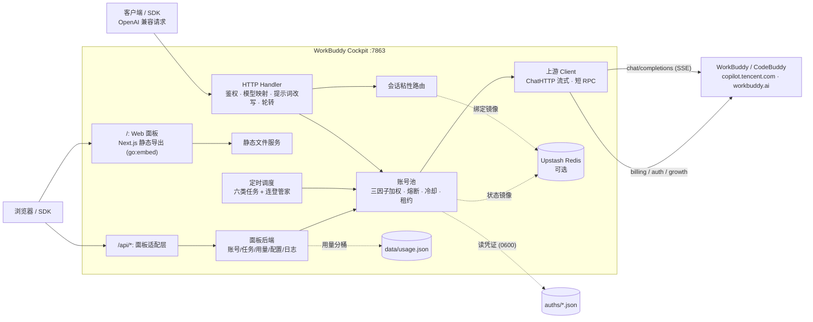

<div align="center">


# WorkBuddy Cockpit

**把 WorkBuddy / CodeBuddy 账号变成 OpenAI 兼容 API，并且管好这一切**

多账号网关 · 内嵌 Web 管理面板 · 任务自动化 · 用量可观测 · 单容器部署

[](https://github.com/Arimayuki03/workbuddy-cockpit/releases/latest)
[](https://github.com/Arimayuki03/workbuddy-cockpit/releases/latest)
[](https://github.com/Arimayuki03/workbuddy-cockpit/actions/workflows/build.yml)
[](LICENSE)
[](https://go.dev)
[](web/)
[](https://github.com/Arimayuki03/workbuddy-cockpit/pkgs/container/workbuddy-cockpit)
[](https://github.com/Arimayuki03/workbuddy-cockpit/stargazers)

**简体中文** · [功能总览](#-功能总览) · [快速开始](#-快速开始) · [配置](#️-配置) · [架构](#️-架构总览) · [版本](#-版本) · [文档](#-文档) · [免责声明](#️-免责声明)

</div>

---

## 📖 项目简介

WorkBuddy Cockpit 是一个自托管的一体化项目：**后端**是多账号 OpenAI 兼容网关（OAuth 登录、账号池轮转、熔断与冷却、会话粘性），**前端**是内嵌进同一个二进制的全功能 Web 管理面板（账号、任务、用量、配置、日志），部署一个容器、记住一个地址，全部搞定。

> 前身是 [Sliverkiss/workbuddy2api](https://github.com/Sliverkiss/workbuddy2api) 的 fork（**上游仓库自 2026-09-23 起已被作者删除、不可访问**，链接仅为历史署名；本项目按 MIT 独立继续演进）。v1.2.0 起项目以独立形态演进：吸收 [workbuddy2api-panel](https://github.com/linguo2625469/workbuddy2api-panel) 的后端管理能力与 [workbuddy-manager](https://github.com/ithtelab/workbuddy-manager) 的前端设计，网关核心与上游保持同源兼容。设计决策见 [docs/DESIGN-v1.2.0-panel-manager.md](docs/DESIGN-v1.2.0-panel-manager.md)。

### 与上游 / 同类项目的关系

| | 上游 workbuddy2api | workbuddy2api-panel | workbuddy-manager | **本项目** |
|---|---|---|---|---|
| 形态 | 纯网关，无面板 | 网关 + 原生 HTML 面板 | 外挂面板（Python 中间层 + Next.js） | **网关 + 内嵌 Next.js 面板** |
| 部署 | 单容器 | 单容器 | 网关 + 面板双容器 | **单容器** |
| 账号池治理 | ✓ | ✓ | —（调网关 API） | ✓（上游同源 + cost_explore） |
| 任务自动化 | ✓ 内置七类调度 | ✓ 全内置 | 依赖 Python 脚本 | ✓ 内置调度 + 成长任务/顺序任务链一键自动化 |
| 用量统计 | `/v1/stats` 聚合 | 逐请求分桶 | 自建 SQLite | **两者都有** |
| Windows 工作流 | ✓ cmd 启停脚本 | — | 脚本 | ✓ cmd 启停 + bat 交互菜单 + CLI 全套 |

## ✨ 功能总览

### 🔑 多密钥分发（wbk_）

面板「API 密钥」页可创建多把独立分发密钥（`wbk_` 前缀），替代单一全局 `api_key`（全局 key 仍兼容可用）。每把密钥独立可设：**realm 版本限定**（cn / global / 不限）、有效期、最大 IP 数、IP 白名单（CIDR）、模型白名单、Token 配额、**积分配额**（按上游真实扣费累计）与每分钟限流。明文仅创建时展示一次，库中只存 SHA-256 摘要；拒绝分类清晰可辨（参数 / 配置问题 400、凭据不可用 403、配额用尽 429 `insufficient_quota`），只有放行成功的请求才计入限流窗口与用量。创建弹窗内可一键导出 9 种客户端配置片段（Claude Code / Codex / cc-switch / ZCode / OpenAI SDK 等），密钥填错方向的问题一次消灭。

### 🔀 双协议直连（Anthropic Messages + OpenAI Responses）

- **Anthropic Messages API**（`/v1/messages` + `/v1/messages/count_tokens`）— Claude Code 等 Anthropic 协议客户端免转换层直连；`thinking` 的 enabled / adaptive 两态都支持；tool_result 内嵌图片正确提取为视觉输入（不再把 base64 塞进文本撑爆上下文）；count_tokens 按 CJK / 非 CJK 分类保守估算；鉴权与 chat completions 同口径（同一把 key）。流式经 io.Pipe 边生成边翻译下发（v1.17.1 前为全量缓冲伪流式）；并行 tool_calls 按上游 `index` 分槽成块，参数交错分片不串块（v1.17.1）。
- **OpenAI Responses API**（`/v1/responses`）— Codex 等 Responses 客户端直连；instructions / input items 完整转换、reasoning item 宽容回填（防上游 11155「推理内容缺失」死循环）、`prompt_cache_key` 透传（缓存命中后费用差约 17 倍）、namespace 工具桥接为 function call；非流式工具调用回传客户端原名而非内部出站名（v1.17.1）。

### 🔎 联网搜索协议壳（`POST /v1/search/messages`）

面向 DSH 内置搜索 provider：把搜索 baseURL 配到 `<网关>/v1/search` 即可发出 Anthropic Messages 兼容的 `web_search` 请求，网关直接调用上游 `/agenttool/v1/search` 并返回 `web_search_tool_result` + citations 结构，不做模型调用。与 chat 共用 `withAuth` / IP 黑白名单 / 全局 api_key / 面板会话通道，并复用账号池选号、在途租约、token 预刷新与 `applyErrorPolicy` 冷却；不新增未鉴权入口。**`wbk_` 分发密钥在该端点显式 403**：搜索不产生模型 token/credit usage，在搜索配额语义定义前不放行，避免绕过既有模型/token/积分限制。`allowed_domains` / `blocked_domains` / `user_location` / `stream=true` 因上游不支持而显式 400（不静默忽略）；每次请求执行一次搜索、`max_results` 上限 10。测试仅使用 fake upstream，未做真实外部搜索验证。

### 🛡️ 入站 IP 安全

`security` 配置段（`trusted_proxy_cidrs` / `trusted_proxy_hops` / `ip_blacklist` / `ip_whitelist` / `ip_whitelist_mode`）：**默认零配置完全不信任转发头**——直连部署下伪造 `X-Real-IP` 无法绕过任何 IP 管控；反代 / CDN 后部署按网段声明可信代理，网关才从 `X-Forwarded-For` 还原真实来源（多跳场景 `X-Real-IP` 一律不采信、只走 XFF 从右往左穿透，v1.17.1）。面板「安全」页提供 IP 规则热编辑（校验失败整体不生效、绝不因"回滚"清空已存规则，v1.17.1）、拦截日志（只记拦截，环形 512 条）与模型锁池卡片；规则文件读盘 / 解析失败时明确告警并保留原文件供排查，不静默回落（v1.17.1）。

### 💰 credit_floor 积分保底

`pool.credit_floor`（0 = 关）：积分低于保底线的账号不接收费模型（按模型积分倍率折算成本判断），防止触底号继续烧费；全冷却兜底路径同判据，不给触底号留暗门；倍率表启动预热，模型目录更新即刷新。签到回血后账号自动恢复接单。

### 🎛️ Web 管理面板

浏览器打开即用，与网关同端口同鉴权，明暗主题，简中 / 繁中 / 英 / 日 / 韩五语言：

- **总览** — 账号健康分布、今日请求 / token / 积分扣费一目了然；到期积分按天归并口径切换（本地偏好）
- **账号** — 池总览（状态 / 积分进度条 / 冷却倒计时 / 成功失败计数 / 在途数）；单号禁用 / 恢复 / 复活 / 签到 / 查余额 / 移除；批量签到 / 保活 / 余额刷新；**扫码 / 授权登录添加账号**，凭证落盘后热加载进池，免重启；**凭据导出 / 导入**（跨部署迁移账号，同 UID 覆盖更新）；**强制清冷却**（冷却 / 熔断 / 连败降权 / 模型级限流一键归零，不碰禁用位）；**账号备注**（后端持久化进 state.json，换浏览器不丢）与**搜索 + 分页**；**手写选号权重**（天平图标，`0.1..100` 乘数，默认 1；持久化进 auth 文件顶层 `weight`，导出/导入与 token 刷新保留；冷却/熔断/禁用/在途/成本分层/`credits_desc` 硬门槛不受影响）；积分变动流水（余额刷新对比快照，增加即记）
- **任务** — 成长任务一键自动化（25 个任务动作纯 API 完成：推进 → 轮询计分 → 自动领奖，执行队列账号内串行、账号间并发；含小程序 Sequential_Tasks_1..7 顺序任务链——专家对话、5/10 次对话、GLM5.2、灵感功能等，链式依赖每日解锁自动重试，**锁定环不扫入待办**，小程序对话上报按真人节奏执行——每条间隔 45s+ 随机抖动、可被队列取消中断）；历史券码二维码查询（开学季任务闭环已随活动 2026-09-24 结束下线）；六类定时任务快照与手动触发；**积分变动流水**（任务中心记录流 kind=credit）
- **统计** — 逐请求用量分桶（时间片 × 域 × 账号 × 模型）时间轴图表 + 按模型 / 账号聚合的请求量 / token / 延迟 / 扣费 / **积分（含积分每百万 token 单价，与积分同时观测的配对 token 才计入比例）**；时间窗筛选图和表同步生效；时间窗含近 24h / 72h / 7d / 30d 数字档与「启动以来」全量档
- **日志** — 请求日志（模型 / 账号 / 状态 / tokens / 首字延迟 / 扣费 / 错误 / **prompt 缓存命中三段观测**，环形缓冲最近约 1000 条）+ 系统日志（任务 / 对话 / 系统三频道）；请求日志可 **JSONL 归档**（`data/requests/` 按天轮转，重启不丢，`logging` 段配置保留天数与容量上限；client_ip / user_agent 脱敏开关默认不采集）
- **安全** — **IP 黑 / 白名单规则编辑**（CIDR，热生效）、**拦截日志**（只记拦截，环形 512 条：missing_key / invalid_key / ip_blocked / ip_not_whitelisted）、**模型锁池卡片**（locked / starved / partial 三态、最早 / 全部解锁时刻）
- **API 密钥** — **多密钥分发管理**（见上）：创建 / 停用 / 用量清零 / 已绑定 IP 查看，创建弹窗内一次性提供 9 种客户端配置片段
- **设置** — 配置热编辑（深合并原子写回，部分键立即生效，排程小时免重启热改，已拆子路由）、Upstash 连通性测试、**模型映射**（自定义模型名 → 真实模型，服务 cc-switch 等写死模型名的客户端）、**作用域 API Token 管理**（`wbt_` 前缀，只读 / 管理两档，供 CI / 脚本调面板 API）、版本检查提示；⌘K 命令面板全局可用，加载失败与空态区分、全局错误兜底页
- **Playground** — 面板内直接对话测试，走本网关 `/v1/chat/completions`

### 🐝 账号池治理

- **OAuth 设备授权登录** — `login.sh` / 面板内扫码加号，token 自动刷新、凭证落盘、热加载
- **三因子加权随机选号** — 积分比例 ×10 + 快过期积分占比 ×8 + 闲置补偿，Top-5 候选短名单内抽签，防惊群；`pool.pick_strategy` 可切换 `credits_desc` 余额从大到小严格选号（面板热生效；粘性会话的首次分配同样遵循策略——credits_desc 下新会话绑余额最高号，weighted 下在空闲候选段内按三因子抽签，快过期积分优先消耗对粘性流量生效）
- **在途租约** — 单号最大并发占用限制；`/status` 透出 `in_flight_by_model` 每模型在途台账
- **账本择优** — 按 `usage.credit` 折算每千 token 单价记入 (账号， 模型) 账本，免费 / 便宜的号优先，观测 EMA 平滑、6h 失效
- **成本分层条件探索** — tier 0 垄断时搭车改道探索未知号，承接真实请求零新增上游调用，成功即毕业
- **分级熔断与冷却** — 429 软冷却指数退避、402 硬冷却至次日 04:00（不被软冷却 / 限流覆盖翻型，零余额号不会提前回池）、连败熔断、模型级限流独立冷却（切模型豁免）、WAF IP 级 fail-fast；运维可从面板**强制清冷却**。签到 / 余额刷新自动解冻只清账号级冷却，不重置软限流退避指数与模型级台账（余额恢复不证明 chat 通道健康，避免零余额号反复回池撞 429）
- **模型锁池可见性** — `/status` 透出当前模型级冷却聚合（locked 全锁 / starved 全饿 / partial 部分锁定三态、最早 / 全部解锁时刻）；全池模型级阻塞时 503 返回 `model_blocked` 而非误导性的「无可用账号」，客户端退避策略不再混同
- **会话粘性** — conversation 四键 → prompt_cache_key → 首条 user 消息派生，多轮上下文不跳号；粘性按模型判活
- **双域适配** — 国内版（`copilot.tencent.com`）与国际版（`www.workbuddy.ai`）共享一池，按 realm 或模型名前缀路由

### ⏰ 定时积分任务

七类任务独立排程、独立开关（`schedule.*_enabled`），**触发小时可在面板 / API 热改（免重启）**：签到（09/21 点，尾部自动跑连登管家：7/14/28 档自动兑换 + 抽奖自动抽完）、活跃地图（10 点）、猫猫旅行（09/21 点，领养状态机修正）、token 保活（22 点）、夜猫子（01 点）、任务执行队列（10 点，默认关）、**每日领补偿**（`compensation_*`，默认关——平台活动补偿原需网页「用量管理」手动领，开启后每天自动领一次；有则领、没有就跳过、重复执行不会多领，国际版账号跳过；面板任务页也可「立即执行」当场领并回报几个号领到/共多少积分）。**任务随机化**（`schedule.random_delay_minutes` / `account_delay_min_seconds` / `account_delay_max_seconds`，默认全关）：自动任务可在整点后随机延后 0~60 分钟（偏移按「部署种子 + 日期 + 任务族」确定性派生——重启后当天偏移不变、不同部署互不相同，种子不入日志），批量任务里账号之间可随机错峰 0~600 秒（真人节奏）；只作用于自动排程，面板「立即执行」照旧立即跑。**Token 续期巡检**（`schedule.renew_hours` / `renew_enabled`，默认 [3] 点、缺省关）：按剩余寿命挑号——有效期不足 `pool.expiring_soon` 窗口（默认 7 天）的临期账号主动刷新，覆盖长期闲置无对话流量的号；面板手动停用的账号跳过（摘流量不摘凭证），仅冷却 / 熔断等计时位异常的照常续期。**睡眠补跑**：进程睡眠跨过整点槽位时（如系统休眠 / 宿主机挂起），唤醒后按时间升序自动补跑窗口内（24h）已到点的槽位，同刻多类合并、批内并行；开学季 `school_*` 配置键仅为老配置兼容保留（活动已结束，触发即跳过）。面板与 `/admin/tasks` 均可手动触发；单任务 panic 有 recover 兜底，不会击穿网关进程。**任务奖励只领取补扫**（`schedule.task_sweep_enabled` / `task_sweep_interval_minutes`，默认关、周期最小 15 分钟）：独立于任务队列与活动补偿，只扫描成长任务列表，对上游已报告 `Claimable` 的已完成奖励做前置 accept + claim；不发起对话、不执行任务动作、不自动做耗费聊天的任务，国际版/企业号/禁用/手动停用账号零请求。与任务锁/队列互斥：账号任务锁被占用则跳过该号，任务中心队列 running 时整轮跳过；进程退出随 signal context 停止后续请求（上游任务 API 无 ctx 参数，在途单次 HTTP 请求可能做到自身超时，生产退出最多等 5s 后终止进程）。

### 🔌 OpenAI 兼容接口

- `/v1/chat/completions` 流式 + 非流式（出站强制 stream，SSE 白名单重建，非流式本地聚合）、**`/v1/messages` + `/v1/messages/count_tokens`（Anthropic Messages 协议，Claude Code 直连）**、**`/v1/responses`（OpenAI Responses 协议，Codex 直连）**、**`/v1/search/messages`（DSH 联网搜索协议壳，Anthropic web_search_tool_result 兼容）**、`/v1/models`（effort 档位 / 积分倍率 / 上下文全字段）、`/v1/stats`、`/status`、`/healthz`——同一套鉴权
- 出站改写管线：强制 `stream:true`、`developer` 角色归一、tool_choice 归一、`image_url` 字符串兼容、DeepSeek 思维链注入、`reasoning_effort` 档位降级、工具 schema `enum` 缺 `type` 补推断（Kimi 系 11133）、`reasoning_content` 回填、指纹脱敏、**prompt 缓存命中别名归一**（部分上游 `details.cached_tokens` 有真值而扁平别名留 0 时取全部别名最大正值回写，下游不再误判未命中）；`reasoning_as_content`（默认 false，需重启生效）仅对「整轮无正文且无工具调用」的 reasoning-only 回合把思考文本同时作为 content 下发，content-only 客户端显式开启，双字段客户端保持默认避免重复显示
- **出站修复一批**（吸收两上游实案）：GPT 系 `max_tokens<16` 钳制（防 11133 触发全号轮转）；工具 schema pattern `\_` 转义归一（防 11129 整体拒收）；背靠背 tool_calls 消息合并（防 11148 tool_call_sequence_broken 顶死会话）；11101 bad_params 立即 400 直通不再轮转（确定性失败不伪装成「账号不可用」）；上游超时止损（不换号、不罚号、不喂连败计数）；流式成功判定延后到真成功（上游「200 开流 + 一帧 error」不再把限流号记成健康号、粘性不再被钉死在它身上）
- 系统提示词三模式（passthrough / custom / append）+ 内容拦截降级重试
- 模型映射、错误分类轮转退避；国际版模型目录**多 UA 并发探测取并集**（桌面 / IDE / CLI 三路 UA——桌面 UA 补齐、IDE UA 字段权威、CLI UA 补 deepseek 系缺失 id），试用横幅模型自动补入目录；上下文窗口按「远端权威 → 静态知识表 → model.json 缓存 → models.dev 按需拉取」四级回退

### 🖥️ Windows 原生工作流

**启动服务.bat** 交互菜单（积分 / 签到 / 任务 / 启停 / 日志 / 加号 / 统计 / 账号运维），`login.exe` / `credit.exe` / `acct.exe` / `stats.exe` / `task.exe` 等 CLI 全套；源码模式 `go run ./cmd/server` 即跑。详见 [使用指南.md](使用指南.md)。

## 🚀 快速开始

### 方式一：Docker Compose（推荐）

```bash
git clone https://github.com/Arimayuki03/workbuddy-cockpit.git
cd workbuddy-cockpit
mkdir -p config && cp config.example.json config/config.json
# 编辑 config/config.json：至少设置 api_key；开启 panel 或 admin 时 api_key 必填（缺失 fail-fast）
docker compose up -d --build

# 打开面板
# http://localhost:7863/   →  登录密码 = 你设置的 api_key
```

> 也可以用 CI 预构建镜像 `ghcr.io/arimayuki03/workbuddy-cockpit:latest`（多架构 amd64/arm64；把 compose 里的 `build: .` 换成 `image:` 即可）。ghcr 镜像由 [Build & Publish](.github/workflows/build.yml) 在每次打 `v*` tag 时发布；发行版二进制（Windows zip / Linux / macOS，含任务工具 exe 与 sha256 校验）随 Release 资产自动上传。若拉取不到镜像，Workflow 页面另有 amd64 离线 tar.gz 供下载。

添加账号：面板「账号」页扫码 / 授权登录，或 `./login.sh`。

### 方式二：源码构建

```bash
# 前端面板（需要 Node 22+，产物 embed 进二进制）
cd web && npm ci && npm run build:export && cd ..
cp -r web/out internal/panel/dist   # Windows: robocopy /MIR web\out internal\panel\dist

# 后端（-tags embed_panel 启用面板内嵌；无该 tag 则为纯网关构建）
go build -trimpath -tags embed_panel -ldflags="-s -w" -o wb2api ./cmd/server
./wb2api -config config.json
# 开发态直跑：go run ./cmd/server -config config.json
```

> ⚠️ `go build` 开启 `-tags embed_panel` 而 `internal/panel/dist/` 缺失时**编译直接报错**（fail-fast：不嵌入残缺前端），请先完成前端构建与拷贝。

### 方式三：Windows 一键脚本

双击 **启动服务.bat** 交互菜单即可（自动编译所需工具、自动检测端口与僵死进程）。发行版 exe 双击即可用：配置文件不存在时首启引导会自动生成带随机 `api_key` 的最小 `config.json` 并打印密钥（双击报错窗口保持可见）。详见 [使用指南.md](使用指南.md)。

### 方式四：NanoPi R28S / OpenWrt ARM64

在 FriendlyWrt / OpenWrt（aarch64、约 1 GiB 内存）上以**单容器 + host 网络**运行：`/opt/wb2api/{config,auths,data}` 三个目录 bind mount，主程序与 `resolv.conf` 只读挂载；另有一个 procd 托管的 `wb2api-admin-proxy`，把内网 / Tailscale 的 `17863` 转发到 `127.0.0.1:7863`。

部署手册使用通用路径与地址占位符，包含停服备份、上传与运行文件校验、失败回退和鉴权验收步骤；管理桥为可选组件，需自行提供。

- 完整目录布局、`docker run` 参数、低写入 / 升级 / 备份 / 安全边界：[docs/DEPLOY-R28S.md](docs/DEPLOY-R28S.md)
- 适用场景：ARM64 小主机 / 软路由 / NAS；x86 与桌面端仍推荐方式一 / 二 / 三

### 验证

```bash
# 网关身份与健康
curl -s http://localhost:7863/healthz

# 模型列表 / 账号状态 / 请求统计
curl -s http://localhost:7863/v1/models  -H "Authorization: Bearer your-api-key"
curl -s http://localhost:7863/status     -H "Authorization: Bearer your-api-key"
curl -s http://localhost:7863/v1/stats   -H "Authorization: Bearer your-api-key"

# 流式聊天
curl -sN http://localhost:7863/v1/chat/completions \
  -H "Authorization: Bearer your-api-key" -H "Content-Type: application/json" \
  -d '{"model":"deepseek-v4-flash","messages":[{"role":"user","content":"hi"}],"stream":true}'
```

### 接入客户端

v1.16.0 起 Claude Code 与 Codex 可**免转换层直连**（Anthropic 协议走 `/v1/messages`，Responses 协议走 `/v1/responses`，配置示例见[使用指南](使用指南.md)）；面板「API 密钥」页创建密钥时可直接导出对应客户端的配置片段。

以 **cc-switch**（Claude Code 等 Anthropic 协议客户端的本地转换器）为例：

- **Base URL**：`http://127.0.0.1:7863/v1`，**API Key**：`config.json` 的 `api_key`（或多密钥分发的 `wbk_` 密钥）
- **模型映射建议**：Default / Sonnet / Opus → `deepseek-v4-pro`；Haiku / Subagent → `deepseek-v4-flash`
- 客户端写死的模型名（如 `gpt-4o`）可在面板 `/settings` 模型映射里整名映射到网关模型

## ⚙️ 配置

配置以 [`config.example.json`](config.example.json) 为完整参考，`WB2A_*` 环境变量可覆盖（含 `WB2A_CONFIG` 指定配置路径）。常用段：

```jsonc
{
  "listen": ":7863",            // 监听地址
  "api_key": "your-gateway-key", // 网关鉴权 key（panel/admin 开启时必填，缺失拒绝启动）
  "auth_dir": "./auths",        // 账号凭证目录（5s 轮询热加载）
  "upstash": { "url": "", "token": "" }, // 状态镜像到 Upstash Redis（可选）
  "usage":   { "enabled": true },  // 逐请求用量分桶落盘 data/usage.json
  "panel":   { "enabled": true, "loopback_only": false }, // Web 管理面板
  "schedule": { "checkin_enabled": true, "checkin_hours": [9, 21], "queue_enabled": false } // 七类任务排程（面板可热改；含每日领补偿与任务随机化）
}
```

| 新增键 | 默认 | 说明 |
|---|---|---|
| `panel.enabled` | `true` | 启用 Web 面板（关掉即回到纯网关形态） |
| `panel.loopback_only` | `false` | 面板仅限本机回环访问（公网反代场景保持 false） |
| `usage.enabled` | `true` | 逐请求用量分桶统计（关掉则统计页只剩 `/v1/stats` 聚合） |
| `schedule.queue_hours` / `queue_enabled` | `[10]` / `false` | 任务中心执行队列排程（默认关；面板任务页可手动触发） |
| `schedule.renew_hours` / `renew_enabled` | `[3]` / `false` | Token 独立续期巡检：对有效期不足 `pool.expiring_soon` 窗口的临期账号主动刷新令牌（面板手动停用号跳过） |
| `pool.pick_strategy` | `weighted` | 选号策略：`weighted` 三因子加权随机 / `credits_desc` 余额从大到小严格选号（面板设置页热改，免重启） |
| `pool.credit_floor` | `0` | 积分保底线：低于该值的账号不接收费模型（按模型倍率折算成本），防触底号烧费；0 = 关 |
| `pool.prefer_expiring` | `true` | 快过期积分优先消耗：最早到期且仍有余量的账号在加权选号给 ×3 权重、会话粘性可用列表放 3 份（不采纳上游硬排序，保留原三因子，可与 `credits_desc` 共存）；`false` = 旧行为（面板热改，下一个余额刷新周期生效） |
| `cooldown.credit_exhausted` | `""` | 积分耗尽的冷却时长：留空 = 旧行为（硬冷却到次日 04:00 等签到）；填 `10m`/`1h` 则只退出这一段、到期自动回池（固定时长不堆加；面板热改，`WB2A_CREDIT_EXHAUSTED` 可覆盖） |
| `schedule.random_delay_minutes` / `account_delay_min_seconds` / `account_delay_max_seconds` | `0` / `0` / `0` | 自动任务随机延后 0–60 分钟 与 账号间随机错峰 0–600 秒（默认全关；偏移按部署种子 + 日期 + 任务族确定性派生，重启当天不变、种子不入日志；只作用于自动排程，需重启生效） |
| `schedule.compensation_enabled` / `compensation_hours` | `false` / `[]` | 每日领活动补偿（默认关；小时**留空 = 只手动执行**、不会被回落成默认整点；国际版与停用号跳过；面板任务页可「立即执行」，`POST /api/compensation/run`） |
| `schedule.task_sweep_enabled` / `task_sweep_interval_minutes` | `false` / `15` | 任务奖励**只领取**补扫（默认关、opt-in；周期最小 15 分钟，小于 15 配置直接报错）。只对上游已报告 Claimable 的已完成任务做 accept/claim，不跑对话/任务动作；与任务锁、任务中心队列互斥；国际版/企业号/禁用/手动停用号跳过。需重启生效（进程退出随 signal context 停止后续请求，在途单次请求受既有 HTTP 超时约束） |
| `reasoning_as_content` | `false` | reasoning-only 回合把 `reasoning_content` 同时作为 `content` 下发（仅当整轮无正文且无工具调用）。默认 false 防双字段客户端重复显示；content-only 客户端用 `true` 或 `WB2A_REASONING_AS_CONTENT=1` 开启；`/v1/chat/completions`、Anthropic、Responses 正常帧序不变。**需重启生效**：main 启动期写入进程级开关，面板保存只落盘并提示重启，不做热更新 |

`security` 段（入站 IP 安全，均可在面板「安全」页热改）与 `logging` 段（请求日志归档，**归档默认关**）：

```jsonc
{
  "security": {
    "trusted_proxy_cidrs": [],   // 可信代理网段（CIDR）。默认空 = 完全不信任转发头，
                                 // 直连部署最安全；反代/CDN 后部署才需要配
    "trusted_proxy_hops": 1,     // 可信代理层数（X-Forwarded-For 从右往左取第几跳，
                                 // <1 按 1 处理）；前面还挂 CDN 时调成 CDN + 反代的层数
    "ip_blacklist": [],          // 黑名单 CIDR，命中即拒（优先于白名单）
    "ip_whitelist": [],          // 白名单 CIDR
    "ip_whitelist_mode": false   // true 且白名单非空 = 仅放行白名单（默认拒绝）
  },
  "logging": {
    "request_archive": false,       // JSONL 归档开关（默认关，开档才写 data/requests/）
    "request_retention_days": 7,    // 归档按天保留上限
    "request_archive_max_mb": 200,  // 归档总容量上限（超限删最旧）
    "request_client_info": false    // 采集 client_ip / user_agent（脱敏开关，默认不采集）
  }
}
```

> ⚠️ 反代部署务必配置 `trusted_proxy_cidrs`（如 nginx 同机的 `127.0.0.1/32`、Docker 网桥 `172.16.0.0/12`），否则网关看到的永远是反代地址，IP 白名单与密钥 IP 管控无法按真实来源生效；反之直连部署保持默认空，任何人伪造 `X-Real-IP: 9.9.9.9` 都不会绕过 IP 管控。

安全契约：`panel.enabled` 或 `admin.enabled` 为 true 且 `api_key` 为空时**拒绝启动**。面板与 API 同端口同鉴权，自带严格 CSP 等安全头；登录失败限速（按 IP 10 分钟内 5 次失败锁定 15 分钟，防 api_key 在线穷举）；公网部署务必设置 api_key 并置于 HTTPS 反代之后。

> ⚠️ 合规须知：本项目是**非官方**网关，使用 WorkBuddy / CodeBuddy 账号作为上游，**仅限本人授权账号、本机 / 私有环境测试**。详细边界见[免责声明](#️-免责声明)。

## 🏗️ 架构总览



上游请求在出站前经历统一的改写管线（`internal/upstream/payload.go`）：强制 `stream:true`、`developer` 角色归一、tool_choice 归一、`image_url` 字符串兼容为 OpenAI 对象形态、DeepSeek 思维链注入、`reasoning_effort` 档位降级、`reasoning_content` 回填、指纹脱敏。

### 目录结构

```
workbuddy-cockpit/
├── cmd/                  # CLI 工具源码（server 网关 / login / credit / acct / stats / task …）
├── internal/             # 核心库（auth / pool / scheduler / server / upstream / panel / usage …）
├── web/                  # Next.js 15 面板前端（静态导出后 go:embed 内嵌）
├── scripts/              # 辅助脚本（Python 任务体 / PowerShell 服务启停）
├── docs/                 # 设计文档
├── config.example.json   # 配置模板（复制为 config.json 后填 api_key）
├── docker-compose.yml    # Docker 一键部署
├── Dockerfile            # 三段构建：node:22 → golang:1.26 → alpine:3.20
└── LICENSE               # MIT
```

## 📚 文档

| 文档 | 内容 |
|---|---|
| [使用指南.md](使用指南.md) | 启停 / 配置 / 账号管理 / 接口验证 / 多密钥分发 / 双协议接入 / 入站 IP 安全 / credit_floor / 作用域 Token / 面板用法（含凭据导入导出）/ 常见问题排查 |
| [docs/DEPLOY-R28S.md](docs/DEPLOY-R28S.md) | NanoPi R28S（FriendlyWrt / OpenWrt ARM64）单容器部署：目录布局、管理桥、升级、备份、SD 卡写入与安全边界 |
| [docs/DESIGN-v1.2.0-panel-manager.md](docs/DESIGN-v1.2.0-panel-manager.md) | v1.2.0 面板整合设计定稿 |
| [config.example.json](config.example.json) | 全量配置键参考（含注释级说明） |

## 🔄 版本

| 版本 | 日期 | 说明 |
|---|---|---|
| v1.0.0 | 2026-09-14 | 上游基线（Sliverkiss/workbuddy2api），ghcr 镜像发布流程 |
| v1.1.0 | 2026-09-20 | 吸收上游 2026-09-20 合并：`/v1/stats`、账号停用/恢复/复活端点、auths 热加载、global 域路由 |
| v1.1.1 | 2026-09-20 | `/status` 透出 `in_flight_by_model` 每模型在途台账 |
| v1.2.0 | 2026-09-22 | **项目更名 WorkBuddy Cockpit**；整合 Web 管理面板（panel 后端 + manager 前端壳）、模型映射、请求日志、版本检查；吸收上游两段式治理流水线、`image_url` 兼容等。网关侧 `/v1/*`、`/admin/*`、`/status` 接口契约保持完全兼容 |
| v1.2.1 | 2026-09-23 | 用量页时间窗修复：新增「启动以来」全量档、切窗竞态修复、Y 轴刻度遮挡修复 |
| v1.3.0 | 2026-09-23 | **账号凭据导出 / 导入**——跨部署迁移账号（同 UID 覆盖更新，导出格式与落盘同形） |
| v1.12.0 | 2026-09-24 | 账号表列排序（本地偏好持久化）、日志页昵称列与昵称搜索、仪表盘积分排序扩容、学院抽奖 `draw_uuid` 修复（标准 uuid v4 + 回归测试） |
| v1.13.0 | 2026-09-26 | **选号策略手动切换**——`pool.pick_strategy` 新增 `credits_desc`（按积分余额从大到小严格选号，面板设置页下拉，热生效免重启），默认 `weighted` 行为不变 |
| v1.14.0 | 2026-09-26 | **吸收两上游修复 + 发行流程固化**——任务待办过滤 locked 环（顺序任务链不再空跑）、签到解冻不再重置软限流退避与模型级冷却（旧语义下零余额号被误判健康回池再撞 429）、usage 缓存命中别名归一（部分上游 `cached_tokens` 真值不再被误判未命中）；CI 打 `v*` tag 自动构建四平台二进制 + 任务工具 exe + sha256 上传 release 资产，镜像 / 二进制统一注入版本号 |
| v1.15.0 | 2026-09-29 | **调度器跨槽补跑 + mp 真人节奏 + usage 积分维度 + 下架开学季**——睡眠跨槽自动补跑（系统休眠 / 宿主挂起后唤醒补齐窗口内错过的整点任务）、小程序顺序任务链对话上报改真人节奏（每条 45s+ 抖动、可被队列取消中断，规避上游反作弊回滚）、用量分桶新增积分维度（积分 / 积分每百万 token 单价，落盘格式 v2 向后兼容）、开学季活动下线（任务与面板入口移除，`school_*` 配置键兼容保留、历史券码查询保留）；面板设置页口径同步（六类任务） |
| v1.15.1 | 2026-09-29 | **镜像构建修复**——多架构镜像的前端 / Go 构建段钉 `BUILDPLATFORM` 原生构建 + Go 按 `TARGETOS/TARGETARCH` 交叉编译，不再走 QEMU 模拟（v1.15.0 的 ghcr 镜像构建在模拟 arm64 内 `next/font` 拉 Google Fonts ETIMEDOUT 失败，release 二进制不受影响）；网关代码与 v1.15.0 完全一致 |
| v1.16.0 | 2026-10-08 | **吸收两上游能力大版本**——**多密钥分发**（`wbk_` 前缀，realm / 有效期 / IP 白名单 / 模型白名单 / Token 与积分配额 / 限流逐把可设，明文仅创建时可见、库中只存 SHA-256，创建弹窗一次性导出 9 种客户端配置片段）；**双协议直连**（Anthropic Messages `/v1/messages` + count_tokens，Claude Code 直连；OpenAI Responses `/v1/responses`，Codex 直连，reasoning item 宽容回填防 11155 死循环、`prompt_cache_key` 透传省费约 17 倍）；**入站 IP 安全**（`security` 段：默认零配置完全不信任转发头防伪造 `X-Real-IP`，反代按网段声明可信代理；面板「安全」页规则编辑 + 拦截日志 + 模型锁池卡片）；**credit_floor 积分保底**（触底号不接收费模型，防烧费）；模型锁池可见性（`/status` 三态聚合 + 503 `model_blocked`）；请求日志 JSONL 归档（按天轮转重启不丢，client_ip/UA 脱敏默认不采集）；**作用域 Token**（`wbt_` 前缀只读 / 管理两档，写操作仅会话 cookie 可用）；账号治理增量（积分变动流水 / Token 续期巡检 `schedule.renew_*` / 账号备注与搜索分页 / 昵称同步）；出站修复一批（GPT 系 max_tokens 钳制防 11133、工具 schema `\_` 归一防 11129、背靠背 tool_calls 合并防 11148、11101 立即 400 直通、上游超时止损不罚号、流式成功判定延后到真成功）；面板 UI（⌘K 命令面板 / 全局错误兜底页 / 加载失败与空态区分 / settings 拆子路由）；运维（docker-compose PUID/PGID 参数化、单文件 bind mount EBUSY 写回回退、签到/余额瞬时错误有界重试、模型目录桌面 UA 第三路探测、tok/s 200ms 护栏、密钥导出片段） |
| v1.17.0 | 2026-10-08 | **个人自用体验轮**——**每账号出口代理线路**（`proxy_routes` 线路表 + 账号绑定 `proxy_route`，http/https 代理，签到/余额/续期/对话全链路走绑定出口，绑定失效线路拒绝出站绝不静默回退，面板账号页「线路」下拉即选即存、URL 脱敏回显，配置热改）；**积分到期提醒**（仪表盘卡片：7/14/30 天窗口、FEFO 先用哪包提示、最紧急 1-3 包明细与完整到期升序列表、数据年龄标注；积分包解析补 `DeductionEndTime` 真失效时刻）；**账号备注后端化**（`note` 字段进 state.json 持久化 + `/api/accounts/{uid}/note` 端点，localStorage 自动迁移到服务器，换浏览器不丢）；**签到已签回显**（「今日已签到」按钮态与提示）；**503 model_blocked 补漏**（全池模型级阻塞时轮转耗尽返回 `model_blocked` + `Retry-After`，不再伪装成「无可用账号」；6004 原因入文案定位根因） |
| v1.17.1 | 2026-10-10 | **审查修复轮**（对 v1.16.0/v1.17.0 两轮 4 提交做全量 OCR 审查 + 双模型交叉验证，73 条评论验证后落地 40 处修复）——**稳定性**：余额刷新昵称表并发写 map fatal（critical）、`a.Nickname` 无锁读写 data race（补 `NicknameValue`/`SetNickname` 访问器全仓收口）、Anthropic SSE error 帧 goroutine 泄漏、`wbt_` 短前缀切片越界 panic、Responses 工具名去重截断越界 panic；**数据安全**：密钥库 Flush 失败后 dirty 不回挂导致停机丢变更、安全页 trusted_proxy 校验失败的"回滚"实为清空旧 IP 规则、iprules 读盘损坏静默回落且覆盖落盘、账号备注迁移在 overview 首载失败时误清空 localStorage；**行为正确性**：模型白名单 `global:` 前缀口径两侧统一（此前照 `/v1/models` 抄写恒 400）、密钥 realm 脏值归一、Anthropic 流式改 io.Pipe 真流式（此前全量缓冲、客户端全程零字节）、并行 tool_calls 按上游 index 分槽（此前串块）、非流式工具调用回传客户端原名、X-Real-IP 多跳时不采信、keys 编辑零值字段可显式清零、备注长度按字符校验、五语言 `settings.tokens.prefix` 键补齐、面板多处未处理 Promise rejection/日期时区漂移/心跳无 catch 修复 |
| v1.18.0 | 2026-10-11 | **积分流水签到记账 + 面板细节修复**——**签到精确记账**（签到/单号签到路径在 `DailyCheckin` 前先查一次余额作基线，签到后按前后差值记「签到到账 +N」流水，`CreditRecord` 新增 `source` 字段；修复根因：原快照比对口径下，签到与上次刷新之间隔着一整天 API 消耗，奖励 +20 常被抵消成净减而「减少不记」，签到永远不落流水——上线一天 16 账号仅 1 条记录；签到后余额同时推进快照基线防双计，基线查询失败只降级不阻塞签到）；**流水来源徽章**（任务中心积分流水表给签到到账渲染橙色「签到」徽章 + 五语言文案）；**账号页分页器修复**（「每页 N 条」下拉固定 `w-[108px]` 装不下中文/日文文案致选中值被裁，改自适应宽度）；**构建规约**（`.gitattributes` 强制 `*.bat`/`*.cmd` CRLF 检出，防 cmd.exe 解析纯 LF 批处理闪退） |
| v1.19.0 | 2026-10-16 | **吸收两上游修复与增强（自用轮，10 个任务区并行实施）**——**11148 判请求级错误**（工具调用/结果配对错乱对同一 body 是确定性的：不再轮转全池、不再喂连败——此前会把健康号逐个打出池；改为立即 400 透传上游原文 + hint 指向「开新会话」）；**空 `function.name` 的 tool_call 剔除**（防线上 11133）；**`prompt_cache_key` 无 `conversation_id` 时回退会话键**（跨轮缓存不再退化成 `sha256(uid+"|")` 常量键，补钉住用例）；**越界 `max_tokens` 上限钳制**（客户端按剩余额度算出的 99 亿不再被上游包成 503 `no_healthy_account` 而反复重试）；**`cooldown.credit_exhausted` 积分耗尽冷却可调**（留空 = 旧行为：硬冷却到次日 04:00；填 `10m`/`1h` 则只退出这一小段、到期自动回池，中途充值或额度刷新即可用上；`WB2A_CREDIT_EXHAUSTED` 可覆盖、面板热改、非法值启动报错含键名）；**私网/本机目标自动直连不走出口代理**（账号绑定线路时上游在本机/内网不再被绕死；判定零分配，http/https 校验不变）；**夜猫子跳过手动停用号**（仅夜猫口径——夜猫是真实对话，让位号不参与；旅行/成长/签到照常）；**任务补领两修**（任务中心「达标未领」入队自动补领，修 `growthPending` 旧口径；mp 对话任务 accept 后回读真实 target，三处入口同修——此前少报事件致 claim 报 400）；**模型映射兜底键 `*`**（接住所有未命中映射的模型名、精确条目优先；副作用：拼错的模型名也会被接住）；**`/v1/models` 第三方目录兼容字段**（`modalities.input` + `supported_reasoning_levels`，只增不改，服务 Magpie 类只读这两个字段的客户端）；定格：全仓 24 包测试绿 + 面板 tsc/lint/静态导出三绿 + dist 清空重放（17 页 / 205 文件） |
| v1.19.1 | 2026-10-16 | **第二波：任务自动化 + 可观测（四件）**——**每日领补偿**（`schedule.compensation_*` 默认关：平台活动补偿一键领——有则领、没有就跳过、重复执行不会多领、国际版与停用号跳过；面板任务页「立即执行」当场跑并回报"几个号领到 / 共多少积分"，`POST /api/compensation/run`；端点 = 计费基址 `POST /billing/meter/compensation-status` + `/claim-compensation`，**实测必须打 codebuddy.cn 且不带 `/v2` 前缀**——`/v2` 路径会 404 并伪装成"今天没得领"；业务拒绝（code≠0）视为正常"无可领"，HTTP 4xx/5xx 才是真错误）；**任务随机延后 + 账号错峰**（`random_delay_minutes` 0–60 与 `account_delay_min/max_seconds` 0–600，默认全关；偏移用「部署种子 + 日期 + 任务族」sha256 确定性派生、重启当天不变、种子不入日志；排程内核重写为**槽位枚举**——同小时先后两个延后槽位（如 09:12 旅行 / 09:37 签到）都按各自真实时刻派发、不丢槽不重复；仅自动排程，手动立即执行不受影响）；**快过期积分优先消耗**（`pool.prefer_expiring` 默认开：最早到期且仍有余量的账号在加权选号 ×3 虚拟实例、粘性可用列表放 3 份；**不采纳上游「到期升序硬排序 + 删四因子」方案**，保留现有三因子与 `credits_desc` 语义；快照随余额刷新供给，热改下一个刷新周期生效）；**日志 / 用量暴露层**（`/api/request_logs` 补 `from`/`to`/`ip`/`ua` 过滤——复用早已实现却无生产者的 `reqlog.Filter`，面板日志页新增来源 IP / UA 列、起止时间与子串过滤；`/api/usage` 补 `from`/`to` 窗口并回显，面板统计页新增「自定义区间」；日志侧 IP 采集接入可信代理解析，**默认安全口径不变**）；**集成修复**：面板保存配置不再把新任务族静默关掉（`applyConfig` 未知 kind 一律归零的旧行为），新键的"需重启"提示入 `restartRequiredFields`；定格：全仓 24 包测试绿 + 面板 tsc/lint/静态导出三绿 + dist 清空重放 |
| v1.19.2 | 2026-10-16 | **审查修复轮**（OCR 全量审查 51 文件 → 23 条评论逐条验证后全修）——**跨层字段错位（high）**：日志页新列与详情读 `ip`/`ua` 而后端序列化的是 `client_ip`/`user_agent`，来源列恒显示「—」（服务端过滤仍生效、故不易发现）→ 前端 4 处读点与类型声明统一对齐后端 json tag；**补偿「小时清空」清不掉**：`SetHours` 拒空表、`hoursOf` 又优先运行态表，面板/`PATCH /admin/tasks` 提交 `[]`（留空 = 只手动）后仍按旧整点自动领直到重启 → 新增 `scheduler.ClearHours`（写非 nil 空表 + 唤醒重排）并接通面板保存与 admin PATCH 两条路径；**越界钳制的 float64 溢出**：`int64(n)` 在 `1e19` 量级溢出为 MinInt64 致上限钳制静默失效，下限钳制同款溢出还会把「要长输出」的请求压成 16 → 两处均改浮点比较；**界面口径三修**：补偿卡片「保存开关不再吞掉未提交的时刻」+ 禁用口径统一 `canEdit`、统计页「今日请求」改独立今日快照（自定义区间不含今天时不再误显示 0）且 `pickWindow` 不再反复覆盖已填区间、日志页补区间合法性校验 +「归档未开启」空态提示 + 筛选期暂停实时刷新；**其他**：`/api/request_logs` 响应补 `source`/`archive_enabled`、归档读取失败的 500 不再回显绝对路径、`/admin/tasks` 的 `next_fire` 零时点输出空串、补偿末号取消不再误报「半程中断」、账号间隔空串校验与 `toWire` 同口径（不再依赖后端拒绝）、`session_sticky` 进重启段清单 + 五语言重启提示文案补全、`localInputToSec` 抽公共 helper；定格：全仓 24 包测试绿 + 面板 tsc/lint/静态导出三绿 + dist 清空重放（206 文件） |
| v1.19.3 | 2026-10-20 | **401 网关页自动禁用 + R28S 部署手册**——上游鉴权层对已吊销会话直接返回 **401 HTML**（APISIX / openresty），body 没有业务信封，旧分类落入 `ErrClient` 只换号不罚号，死号会留在池里反复 401。新增形态判定 `IsGatewayAuthPage`（只认 **401 + HTML 文档**；纯文本 / 空体 / JSON 信封一律不判，避免凭状态码误杀），聊天、签到、余额、续期、保活、余额刷新六条链路统一自动禁用并写入 `disabled_reason = upstream 401 gateway page (session revoked), re-login required`；面板徽章显示「需重新登录」，`gateway_hint` 与 12153 会话过期分开提示；签到/余额回执不再透传整段 HTML。新增 [docs/DEPLOY-R28S.md](docs/DEPLOY-R28S.md)：NanoPi R28S（FriendlyWrt / OpenWrt ARM64）单容器、host 网络、`/opt/wb2api` 目录布局、17863 管理桥、低写入与 SD 卡注意事项、升级/备份/安全边界 |
| v1.20.0 | 2026-10-22 | **吸收 panel / manager 2026-10-21 可适用更新**——DSH system prompt 指纹重写；11-128 渠道校验软冷却；11151 空消息确定性 400（不轮转/不罚号）；reasoning-only 回合 `reasoning_as_content`（默认 false）+ finish/usage 帧序修复；上游流截断/读中断在 `[DONE]` 前发 `upstream_truncated` / `upstream_read_error`，日志/指标收敛 502 且不记成功；国际版只读余额刷新 + credit ledger，保留强制冷却；global DeepSeek-V4.1-Flash 补 `max`；账号手写权重（`0.1..100`，默认 1，凭据持久化/导入导出/token 刷新保留）；`POST /v1/search/messages`（共用鉴权/IP/账号池，拒绝 wbk_）；任务奖励只领取补扫（默认关、最小 15m、退出取消、任务锁/队列互斥）。迁移与验证限制见 [发行说明](docs/RELEASE-v1.20.0.md) |

| v1.21.0 | 2026-10-26 | **渠道校验守卫 + 思考强度观测 + 吸收 manager v2.10.0**——**11-128 防风控守卫**（命中即抓包留证 `data/channel_check/`、body/模板短 TTL 负缓存本地 400、专用 60s 冷却不占 soft_rate、fail_fast 可选、预置拦截短语；面板「渠道校验守卫」分组**全字段热生效**）；**思考强度全链路**（请求日志 `effort_in/effort_out` + `reasoning_tokens`/`duration_ms`/`realm`，流水行 `eff=` 列，面板「思考强度」列，三协议覆盖）；**缓存写入推导**（上游不下发 write，`write=miss` ≥64 块推导，流式/非流式/统计同口径，精度 ~94%）；**manager v2.10.0 吸收 8 项**（DSH Web GUI 跨句指纹净化、纯 401 连续计数禁用 `ErrAuthRejected`、Kimi 工具 enum 补 type + 11133 快速失败、空流可重试文案、签到限速 3s/号 + 10001/5xx 退避重试、粘性首绑三因子加权、日志思考强度列、Dockerfile GOPROXY）；**面板修复**（提示词模式切换报错——字段全局映射被同名分组覆盖改分组内解析；请求日志页 `table-fixed` 定宽 11 列一屏、账号列显示 uid8）；**流水行定宽**（账号列 18 uid8 后缀保留、eff 列 15、`logfmt.TruncateWidth`）；请求日志持久化与来源采集入面板（采集热改）。迁移与验证限制见 [发行说明](docs/RELEASE-v1.21.0.md) |

完整变更见 [Releases](https://github.com/Arimayuki03/workbuddy-cockpit/releases)。

## 🙏 致谢

- [Sliverkiss/workbuddy2api](https://github.com/Sliverkiss/workbuddy2api) — 网关核心的上游基座（本 fork 的起点；上游仓库已删库下线，署名依 MIT 保留）
- [linguo2625469/workbuddy2api-panel](https://github.com/linguo2625469/workbuddy2api-panel) — 面板后端能力（账号池视图 / 任务自动化 / 开学季 / 用量分桶 / OAuth 加号 / 配置热编辑）的移植源（MIT）
- [ithtelab/workbuddy-manager](https://github.com/ithtelab/workbuddy-manager) — 前端面板设计与页面结构的来源（MIT）；其 UI 设计 token 与组件层改编自 [linux-do/cdk](https://github.com/linux-do/cdk)（MIT），一并致谢

## ⚠️ 免责声明

本项目（包括但不限于代码、脚本、文档、配置示例及仓库内任何资源，下称「本项目内容」）**仅供个人学习与研究使用**。使用本项目表示您已阅读并接受本声明全部条款；如不同意，请立即停止使用并删除全部相关内容。

**1. 用途限制。** 本项目内容仅可用于个人学习、研究等非商业用途；请勿将本项目用于任何商业目的或牟利行为，请勿违反所属国家 / 地区 / 组织的任何法律法规。本项目不构成对任何软件、服务、平台的使用建议或授权。

**2. 账号与数据责任。** 本项目可能涉及个人账号凭证的获取、存储与使用。您应仅使用本人持有且已获授权的账号，自行确认相关平台的服务条款与允许范围，并自行承担使用、存储凭证（如 `auths/` 中的文件）及调用上游服务所产生的全部责任与风险。本项目不参与、不介入您与任何平台之间的契约关系。

**3. 内容与第三方界限。** 本项目内容中引用的第三方产品、服务、LOGO、图片、文案等，其权利均归各自权利人所有；本项目不保证此类内容的准确性、完整性、合法性，亦不代表支持或推荐任何第三方。如实存在侵权情形，请通过 Issues 告知，经核实后本项目会尽快处理。

**4. 无担保与风险自担。** 本项目内容按「现状」提供，不附带任何明示或默示的担保（包括但不限于适销性、特定用途适用性、准确性、不侵权等）。使用本项目（包括直接或间接）所产生的任何风险与后果（包括但不限于账号异常、数据丢失、服务中断、纠纷或损失），均由使用者自行承担，与本项目及其全部贡献者无关。

**5. 责任限定。** 在任何情况下，本项目及其作者、贡献者均不对任何直接、间接、偶然、特殊或后果性损害承担责任，无论该等损害是否基于合同、侵权或其他法律理论，即使已被告知发生该等损害的可能性。

**6. 修改与分发。** 基于本项目源代码进行的任何修改、衍生均系第三方自发行为，与本项目无关，相应后果由该第三方自行承担。本项目内所有资源文件，禁止任何公众号、自媒体进行任何形式的转载、发布。未经授权，任何组织或个人不得将本项目内容用于转载、发布或再分发。

**7. 条款变更。** 本项目保留随时修改、补充本声明的权利。修改后的声明自发布之日起生效，继续使用本项目即视为接受修订后的声明。本项目所有内容仅供学习和研究使用，请于学习研究完成后及时删除。

## 📄 License

本项目采用 [MIT License](LICENSE) 开源协议。

- 在遵守 MIT License 前提下，允许使用、复制、修改、合并本项目源代码
- 再分发（源码或二进制形式）时，须保留本项目及上游 Sliverkiss/workbuddy2api、workbuddy2api-panel、workbuddy-manager 的 MIT 版权声明与许可声明
- 本项目不授予任何上游（WorkBuddy / CodeBuddy）接口或服务的权利；使用者仍需自行遵守上游服务条款
- 本项目的使用同时受上方**免责声明**约束；如免责声明与 MIT License 存在不一致，以免责声明为准

---

<div align="center">

如果这个项目对你有帮助，欢迎点一个 ⭐

</div>
